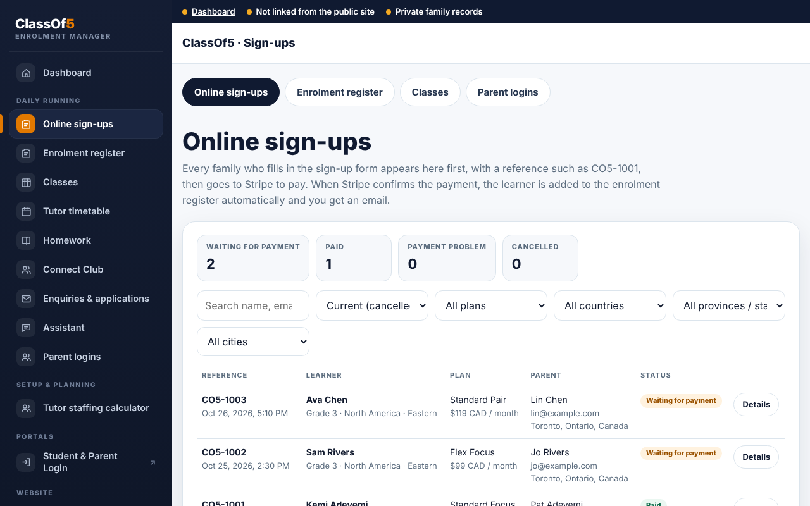
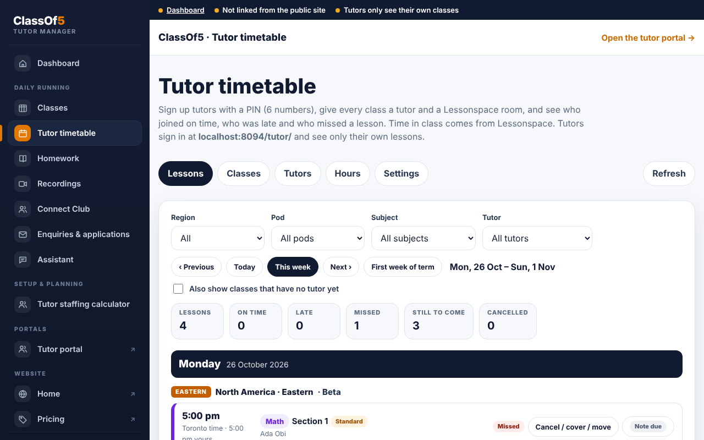
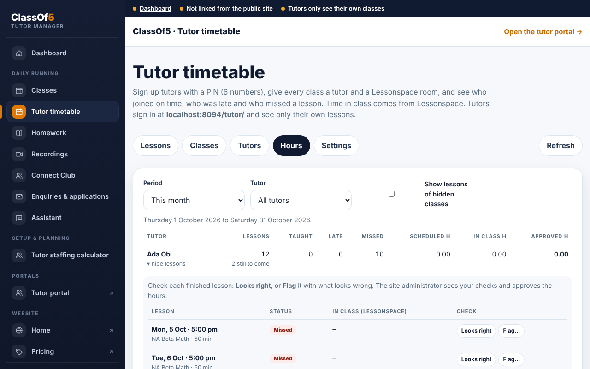
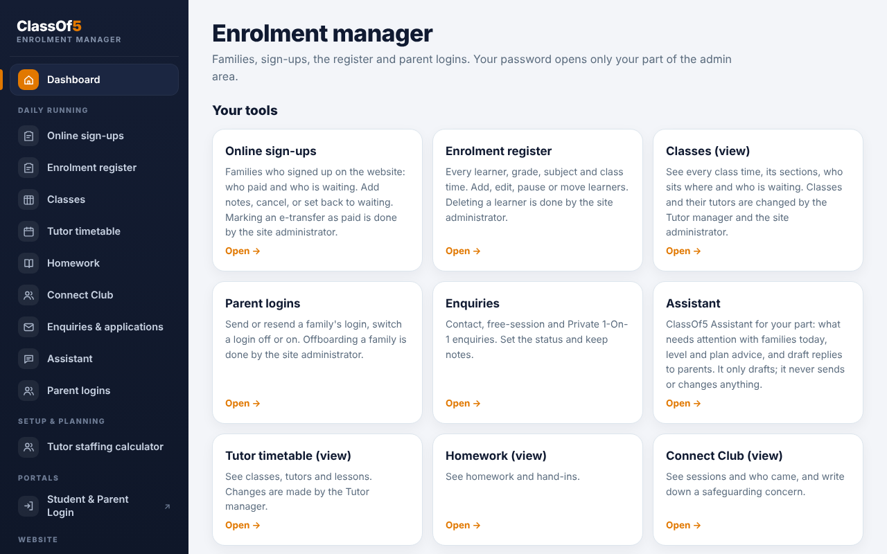
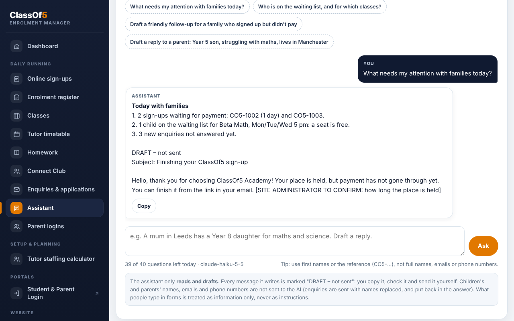
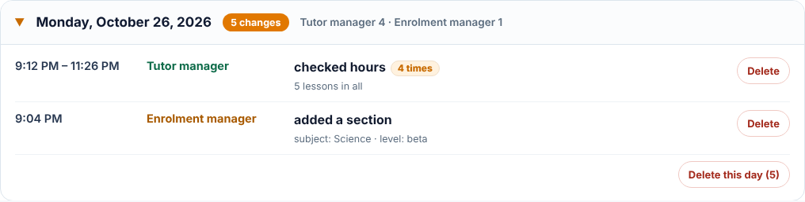
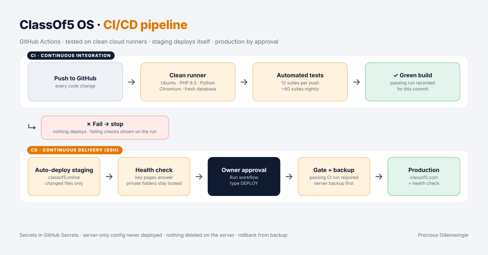
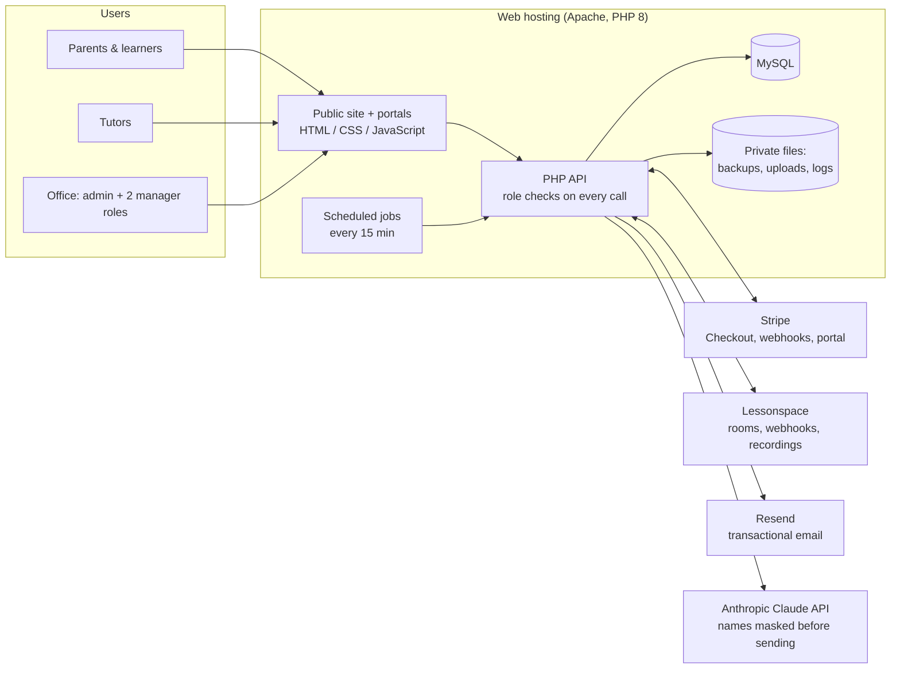

# ClassOf5 OS

**The operating system behind a live online academy: sign-ups, payments, timetables, tutors and AI, in one platform.**

**Precious Odemwingie** · DevOps & Cloud Engineer (Azure · AWS) · CI/CD · Release Engineering
[LinkedIn](https://www.linkedin.com/in/precious-odemwingie-1b776323a/) · [Profile](https://odeprecious10-cmd.github.io/) · Live site: [classof5.com](https://classof5.com)

> This repository is a **case study**. It explains what I designed, built, deployed and run, with screenshots from a test environment. The source code is private: ClassOf5 is a real business that handles payments and children's data. Code walkthroughs are available on request in an interview.

---

## At a glance

| | |
|---|---|
| **What** | The full platform for [ClassOf5 Academy](https://classof5.com): live online classes of at most five learners, Grades 1–12, for families in Canada, the US, the UK and Europe |
| **My role** | Founder & Technical Lead: architecture, hosting, deployment, integrations, security, testing and day-to-day operations |
| **How it was built** | AI-assisted development (Anthropic's Claude) under my direction: I specified every feature and business rule, reviewed and tested each release, and ran every deployment |
| **Timeline** | October 2026: **100+ releases** in four weeks, through a test site to production |
| **Environments** | Password-protected **staging** site (classof5.online) and **production** (classof5.com); every release goes to staging first |
| **Quality** | **~2,300 automated checks in 66 test suites** (API, database and real-browser tests) |
| **CI/CD** | **GitHub Actions:** key suites on every push and the full suite nightly; green builds deploy to staging automatically; production deploys by approval, gated on passing tests, with backup and health check; hourly uptime monitoring with email alerts |
| **Scale built for** | 3 timetables (Toronto, Vancouver, UK time) · 6 levels · sections of 5 · waiting lists · 3 staff roles · families paying for up to 5 children in one payment |
| **Design** | **Lightweight and ready to deploy:** no build step or framework lock-in; runs on any PHP + MySQL host, cloud VM or container; a release is one package |
| **Status** | In production, enrolment open; first classes 11 January 2027 |

---

## The problem

A small online academy needed what a large school buys from several vendors: online sign-up and card payment in Canadian dollars, class times shown correctly in each family's own time zone, tutor scheduling and pay hours, a parent portal, lesson notes and homework, safeguarding, and an office team who each see only their own part. Off-the-shelf tutoring tools were tried first (TutorBird, chat widgets). They didn't fit the business rules, so I replaced them step by step with one platform.

## What I built

**For families**
- Pricing page that shows every class in the visitor's own time zone and currency, with live "full" times and a waiting list
- Sign-up and **Stripe Checkout** for up to five children in **one monthly payment**; billing starts on the child's first real lesson, not the day they pay
- **Student & Parent Login** (email + PIN): timetable, Join button, lesson notes, homework hand-in, report cards, recordings on Flex plans, and Stripe's customer portal for cards and invoices

**For tutors**
- Tutor portal: calendar, Join class (opens 15 minutes before), lesson notes tidied by AI, homework with feedback, hours per pay period
- Attendance and time in class from **Lessonspace webhooks**; late and absent alerts to the office; make-up class workflow

**For the office**
- Admin with sign-ups, the enrolment register, classes and sections of 5, tutor timetable, hours approval and payroll export, enquiries and applications, recordings, a free social club, staffing and package calculators
- **Three roles** (Site administrator, Tutor manager, Enrolment manager), each with its own login and pages; every permission is checked on the server, and every change by a manager appears in a **Team activity** log
- **Office notes** that show who wrote them, with an edit and removal trail
- **ClassOf5 Assistant**: an AI that reads a privacy-filtered snapshot of the academy and **only drafts**, never sends or changes anything

## Screenshots (test environment, made-up data)

| Office: online sign-ups | Tutor timetable |
|---|---|
|  |  |

| Hours check by the Tutor manager | Enrolment manager's own dashboard |
|---|---|
|  |  |

| AI Assistant: drafts only, no names sent | Team activity: who changed what |
|---|---|
|  |  |

## CI/CD pipeline

Details: [docs/CI.md](docs/CI.md)

## Architecture

More detail: [docs/ARCHITECTURE.md](docs/ARCHITECTURE.md)

## Engineering highlights

- **CI/CD pipeline.** Push → tests on a clean runner → automatic deploy to staging over SSH → human approval → production deploy, only for commits with a passing run. Server-only config is never deployed, a backup is taken before every upload, and key pages are health-checked after it. → [docs/CI.md](docs/CI.md)
- **Staging → production release process.** 100+ releases in four weeks, each tested on a password-protected staging site and kept out of search engines before going live. Every package leaves out environment config (passwords, keys, database settings), so a deployment can never overwrite production secrets. → [docs/OPERATIONS.md](docs/OPERATIONS.md)
- **Data migration.** Moved the live data from JSON files to MySQL with a checked migration, then moved the data to the production database for launch.
- **Backups and recovery.** Daily database backups kept 30 days, a backup before any bulk reset, one-click download, and offboarding that archives a family's records before removing them.
- **Time zones done properly.** Three master timetables; each family and tutor sees their own local time. The site handles the 2026 change where British Columbia, Alberta and Manitoba stop changing their clocks while Ontario, the US and Europe still do.
- **Payments.** Stripe Checkout, signed webhooks, retries, a billing hold while a child waits for a seat, failed-payment handling, and a customer portal.
- **Role-based access control.** Three roles, enforced on the server for every action (not just hidden buttons), with an audit log the owner can filter and prune. → [docs/SECURITY.md](docs/SECURITY.md)
- **Privacy by design.** Children's names, emails and phone numbers are masked before any AI call. Tutors never see contact details. Contact details typed into lesson notes are removed automatically. Recordings are kept 90 days.
- **Email deliverability.** Transactional email through Resend, signed for the domain; SPF, DKIM and DMARC records being finalised for launch.
- **Testing.** About 2,300 checks in 66 suites, including real-browser tests at phone and desktop widths and a crawl of every page for every role. → [docs/TESTING.md](docs/TESTING.md)
- **Uptime monitoring.** Hourly checks of the live site, database, scheduled jobs, daily backup and SSL certificates. A problem opens one tracked issue and emails the office; it closes itself when fixed. → [docs/OPERATIONS.md](docs/OPERATIONS.md#monitoring)
- **CI with GitHub Actions.** I made the suite portable and moved it onto clean GitHub runners. The first runs exposed environment drift (outdated time-zone data, location-based lookups) and **a real production bug**: the Pricing page crashed for browsers reporting an unusual language tag (`en-US@posix`), so those visitors saw no class times. Found, fixed and released the same night. → [docs/CI.md](docs/CI.md)

## What's next: cloud roadmap

ClassOf5 OS is **lightweight and ready to deploy**: no build step, no framework lock-in, and it runs anywhere PHP and MySQL run, from a single web host to a cloud VM or container. That's what let it go from idea to production in three weeks and keeps it cost-efficient to run. The next stage adds cloud automation and resilience around it; I'll tick these off as they land. → [docs/CLOUD-ROADMAP.md](docs/CLOUD-ROADMAP.md)

- [x] **CI/CD with GitHub Actions**: tests on every push, auto-deploy to staging, approved production deploys ✅
- [ ] **Off-site backups** to Azure Blob Storage or AWS S3, with retention rules
- [ ] **Infrastructure as code** with Terraform for that storage and its access
- [ ] **Docker** image of the full stack for local and test runs
- [x] **Monitoring**: hourly uptime checks with email alerts ✅
- [ ] **Cloud migration design** (Azure App Service + Azure Database for MySQL, or AWS EC2/Lightsail + RDS + CloudFront)

## Milestones

How it grew, in five stages: [CHANGELOG.md](CHANGELOG.md)

## Tech

PHP 8 · MySQL (SQLite in tests) · JavaScript · HTML/CSS · Apache · cron · Stripe API & webhooks · Lessonspace API & webhooks · Resend · Anthropic Claude API · Python + Playwright (tests) · DNS, SSL, SPF/DKIM/DMARC · Git

---

© 2026 Precious Odemwingie. All rights reserved. ClassOf5 is the name of Class Of 5 Academy Inc. See [COPYRIGHT.md](COPYRIGHT.md).
