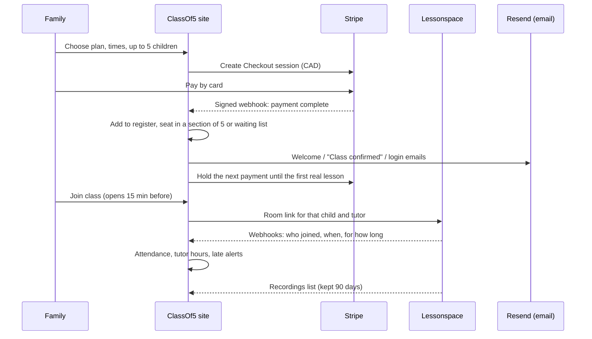
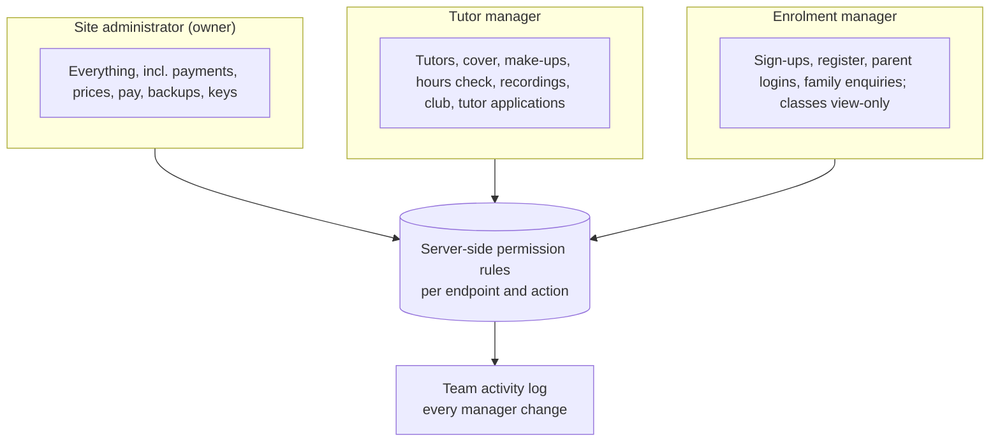

# Architecture

ClassOf5 OS is **lightweight and ready to deploy by design**: no build step, no framework lock-in and very few moving parts. It runs anywhere PHP 8 and MySQL run (a standard web host today, a cloud VM, App Service or container tomorrow), and a release is a single package. Keeping the infrastructure lean put the effort where the value is: the business rules, the integrations, security and operations.

## Integrations

- **Stripe:** Checkout, signed webhooks with idempotent processing, subscription billing anchored to the first real lesson, failed-payment handling, customer portal for cards and invoices.
- **Lessonspace:** a room per tutor or class, synced through the API; webhooks give join and leave times (capped to the lesson); recordings are fetched on a schedule.
- **Resend:** transactional email signed for the domain; a fallback to the host's mail if Resend refuses; the real reason is logged when an email fails.
- **Anthropic Claude API:** lesson-note tidying, homework wording, report-card summaries and the office Assistant. Names are swapped for codes like [L1] before sending, and daily limits apply per tutor, per manager and for the whole school.

## Time zones

Every class belongs to one of three master timetables: North America Eastern (Toronto time), North America Western (Vancouver time) or UK & Europe (UK time). Every page shows each family and tutor their own local time and warns about classes after midnight in a tutor's time or the same tutor booked twice at the same moment. The platform handles the November 2026 change in which British Columbia, Alberta and Manitoba stop changing their clocks while Ontario, the US and Europe continue.

## Roles

