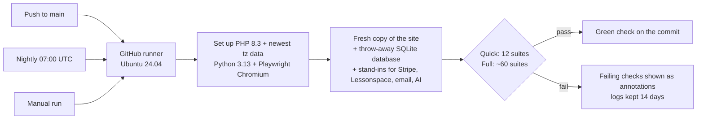
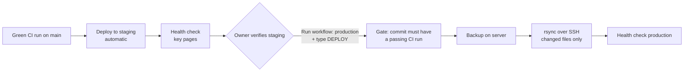

# CI/CD (GitHub Actions)

The source and tests live in a private repository; this page describes the pipeline.

## Pipeline

| | |
|---|---|
| Triggers | Every push and pull request (quick), nightly at 07:00 UTC (full), manual button (quick or full) |
| Runner | `ubuntu-24.04`, fresh for every run |
| Isolation | Each suite resets its own site copy and database; no shared state between suites |
| Secrets | None needed: tests use made-up settings; live config never enters the repository |
| Environment pinning | Time zone set explicitly; newest IANA time-zone data for PHP; country and exchange-rate lookups switched off so a runner's location can't change results |
| Reporting | Pass/fail per suite in the log; failing checks and crash locations as run annotations; full logs as an artifact |
| Maintenance | Actions kept current (moved to the Node 24 versions when GitHub deprecated Node 20) |

## What the first runs found

1. **Outdated time-zone data on the runner.** PHP did not know about the 2026 changes in British Columbia, Alberta and Manitoba. Fixed by installing current time-zone data in CI; the tests were also made to accept any up-to-date server, since the platform corrects old data by itself.
2. **Location-dependent results.** The runner sits in the US, so the Pricing page switched to US dollars. Fixed by switching off geolocation and exchange-rate lookups in CI.
3. **A production bug.** Chromium on the runner reported its language as `en-US@posix`; the Pricing page passed that straight to `Intl.DateTimeFormat`, which threw, so no class times rendered and the visitor could not book. Fixed in the site (sanitise the tag, fall back to `en-CA`), verified with three locales, released the same night.

Local tests had passed throughout: the bug only appeared on a clean machine with different defaults, which is exactly what CI is for.

## Continuous delivery

| | |
|---|---|
| Staging | Deployed automatically after every green CI run on `main` (continuous deployment) |
| Production | Manual approval: run the workflow, choose production, type DEPLOY (continuous delivery) |
| Gate | The deploy job checks the GitHub API for a successful CI run of that exact commit; otherwise it stops |
| Transport | rsync over SSH (port 21098), key in GitHub Secrets, unlocked only on the runner |
| Never deployed | Server-only config (database, payments, keys, prices, site settings), the main `.htaccess`, live data |
| Never deleted | The deploy only adds or updates files |
| Rollback | A code backup on the server before every upload (newest 10 kept) |
| Health check | Key pages must answer; protected folders must stay protected |

The first automatic staging deploy ran on 29 October 2026; the gate had refused an earlier commit whose tests had not passed.
